<div align="center">

# Manoj Rollo
### Senior Digital Test Engineer · QA Manager · Project Manager &amp; AI Builder
<sub>Senior Consultant L2 @ Concept Quality Reply · Turin, Italy</sub>

<br/>

<p>
  <a href="https://manoj.it"></a>
  <a href="https://www.linkedin.com/in/manoj-rollo/"></a>
  <a href="https://github.com/MRJonam91"></a>
  <a href="https://www.instagram.com/mr_jonam/"></a>
  <a href="https://www.youtube.com/@MrJonam91"></a>
  <a href="https://www.behance.net/fbxmanoddc8"></a>
</p>

> 💡 **Interactive Multi-Profile Studio:** Click on any of the sections below to switch between themes right on GitHub!

<p>
  <a href="#-proposal-1-executive--engineering-hybrid-default-view"></a>
  <a href="#-proposal-2-cyber-terminal--biometric-scan"></a>
  <a href="#-proposal-3-living-aurora--project-constellation"></a>
</p>

</div>

---

<details open>
<summary><h3>💎 PROPOSAL 1: Executive &amp; Engineering Hybrid (Default View - Click to Collapse)</h3></summary>
<br/>

<div align="center">

<table width="100%">
<tr>
<td width="58%" valign="middle" align="left">
  <p><sub>🟢 EXECUTIVE &amp; ENGINEERING PROFILE · TURIN, ITALY</sub></p>
  <h2>Manoj Rollo</h2>
  <h4>Senior Digital Test Engineer · QA Manager · Project Manager &amp; AI Builder</h4>
  <p>
    <strong>Senior Consultant L2 @ Concept Quality Reply</strong><br/>
    Software Engineer (<strong>Politecnico di Torino</strong>) &amp; <strong>MBA</strong> with <strong>11+ years of experience</strong> in Test Automation, Performance Engineering, Project Management, Technical &amp; Functional Analysis, and Enterprise AI &amp; ERP/CRM systems.
  </p>
</td>
<td width="42%" valign="middle" align="center">
  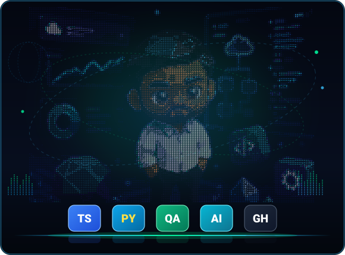
</td>
</tr>
</table>

<table width="100%">
<tr>
  <td width="20%" align="center"><strong>11+</strong><br/><sub>Years of Experience</sub></td>
  <td width="20%" align="center"><strong>35</strong><br/><sub>Open Source Repositories</sub></td>
  <td width="20%" align="center"><strong>61 ★</strong><br/><sub>GitHub Stars</sub></td>
  <td width="20%" align="center"><strong>5+</strong><br/><sub>Roles &amp; Domains</sub></td>
  <td width="20%" align="center"><strong>5</strong><br/><sub>Languages (IT · EN · ES · DE · FR)</sub></td>
</tr>
</table>

</div>

#### 🎯 Strategic Pillars
* **Quality & Performance Engineering**: End-to-end QA pipelines, microservices, load & stress testing (Selenium, JMeter, Gatling, Postman, Jenkins).
* **Project Management & Leadership**: Agile Scrum & Kanban, cross-functional delivery leadership, business & functional analysis (IIBA/CBAP & PMP methodology).
* **AI & Modern Architecture**: Local LLMs (Ollama, vLLM), Model Context Protocol (MCP), WebAssembly sandboxing, offline-first CRDTs.

#### 💼 Career Milestones
* **2025 - Present**: **Senior Consultant L2 (QA Test Engineer & PM)** @ *Concept Quality Reply*
* **2023 - 2025**: **Senior Consultant L1 (QA Lead & Test Automation)** @ *Concept Quality Reply*
* **2022 - 2023**: **Consultant L3 (QA & Performance Engineer)** @ *Concept Quality Reply*
* **2020 - 2022**: **QA Validation Specialist (Load/Stress Testing)** @ *Concept Quality Reply*
* **2018 - 2020**: **Digital Media Engineer & UX Designer** @ *Marcopolo Visualizer*

#### 🛠️ Technical Stack & Telemetry
<div align="center">
  
  <br/><br/>
  
  <br/><br/>
  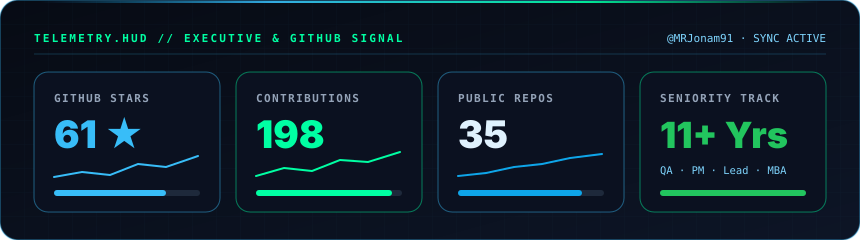
  <br/><br/>
  
</div>

</details>

---

<details>
<summary><h3>📟 PROPOSAL 2: Cyber Terminal &amp; Biometric Scan (Click to Expand)</h3></summary>
<br/>

<div align="center">

<p><code>mrjonam91@quality-reply-node ~ $ ./system-scan --user="Manoj Rollo" --clearance="Senior-Consultant-L2"</code></p>


<a href="https://manoj.it">
  
</a>

</div>

#### `>_ $ neofetch --career-telemetry`

```yaml
┌──[ IDENTITY & CREDENTIALS ]──────────────────────────────────────────────┐
│ User         : Manoj Rollo (@MRJonam91)                                  │
│ Current Role : QA Test Engineer, Project Manager & Team Leader (Senior L2)│
│ Organization : Concept Quality Reply · Turin, Italy                      │
│ Experience   : 11+ Years (QA Automation · Performance · PM · Digital UX) │
│ Education    : Politecnico di Torino (Cinema & Media Eng.) + Exec MBA    │
│ Certifications: Business Analysis (IIBA) · PMP Prep · Strategy (CBAP)    │
├──[ TECHNICAL ARSENAL ]───────────────────────────────────────────────────┤
│ QA & Perf    : Selenium · JMeter · Gatling · Postman · Jenkins · Polarion│
│ Languages    : TypeScript (34%) · HTML/CSS (31%) · Python (22%) · Java   │
│ AI & Systems : MCP · Ollama · RAG · WebAssembly (WASM) · CRDT · Docker   │
│ Spoken Langs : IT (100%) · EN (80%) · ES (45%) · DE (25%) · FR (25%)     │
└──────────────────────────────────────────────────────────────────────────┘
```

#### `>_ $ tail -n 10 /var/log/career-and-repositories.log`
```text
[2025-NOW ] [L2-LEAD] Concept Quality Reply -> QA Test Engineer, Project Manager, Team Leader
[2023-2025] [L1-SEN ] Concept Quality Reply -> QA Test Automation & Performance, Team Leader & PM
[2022-2023] [L3-CONS] Concept Quality Reply -> QA Test Automation & Performance Engineer
[2020-2022] [QA-VAL ] Concept Quality Reply -> Load/Stress Testing (Java, Selenium, JMeter, Gatling)
[2018-2020] [UX-DEV ] Marcopolo Visualizer  -> Digital Media Engineer & UX Designer (Web, CMS, Analytics)
[REPO-AI  ] [ONLINE ] AgentLedger | TokenWatch | WASM-Sandbox | OpenAgentOS | LocalFirst-Agent | MCP-Hub
[REPO-SEC ] [ONLINE ] ZeroAuth (Passkeys/WebAuthn) | privacy-vault-ai (Encrypted RAG) | DataSovereign
[REPO-AUTO] [ONLINE ] OpenAutomationHub (n8n catalog) | freelance-project-checks | cycleAI | EdgeSync-CRDT
[REPO-CIV ] [ONLINE ] CityMirror | gtt-live-plus | posso-guidare-torino | sciopero-oggi | benzina-radar
[REPO-WEB ] [ONLINE ] pokematrix | disney-lorcana-companion | TorinoTramTour | atlante-della-birra | Calice
```

<div align="center">
  
  <br/><br/>
  
  <br/><br/>
  
  <br/><br/>
  
</div>

</details>

---

<details>
<summary><h3>🌌 PROPOSAL 3: Living Aurora &amp; Project Constellation (Click to Expand)</h3></summary>
<br/>

<div align="center">

<p><sub>✦ MANOJ ROLLO · DIGITAL ENGINEER, QA MANAGER, PM &amp; AI BUILDER · TURIN, ITALY ✦</sub></p>


<br/><br/>

<p>
  <strong>Senior Consultant L2 @ Concept Quality Reply</strong> · <strong>11+ Years of Experience</strong><br/>
  <em>Test Automation · Performance Engineering · Project Management · Business Analysis · AI &amp; Digital Media</em>
</p>

</div>

<p align="center">
  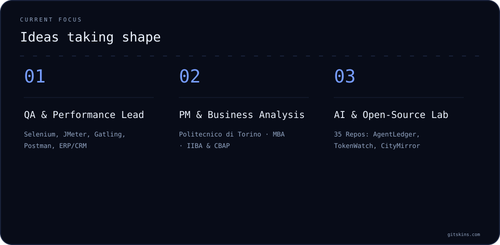
</p>

#### 🌌 Project Constellation & Timeline

<p align="center">
  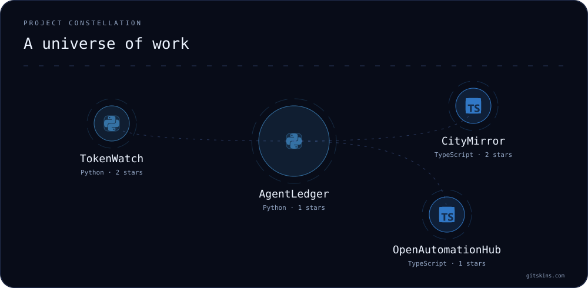
  <br/><br/>
  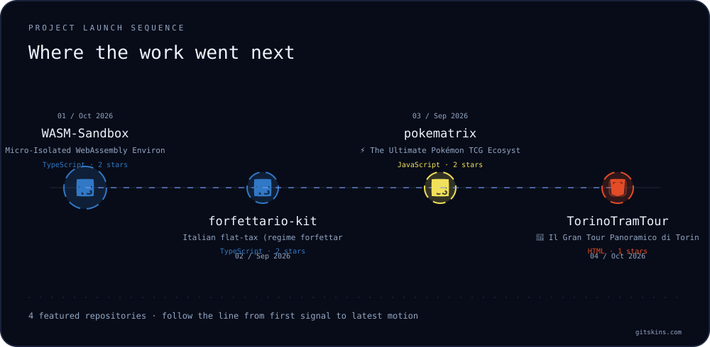
</p>

#### 🛠️ Technology Stack & Contribution Heatmap

<p align="center">
  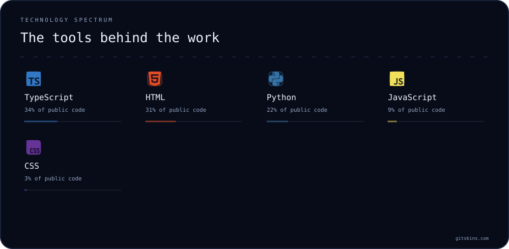
  <br/><br/>
  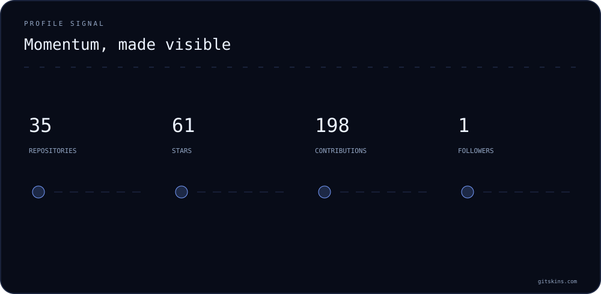
  <br/><br/>
  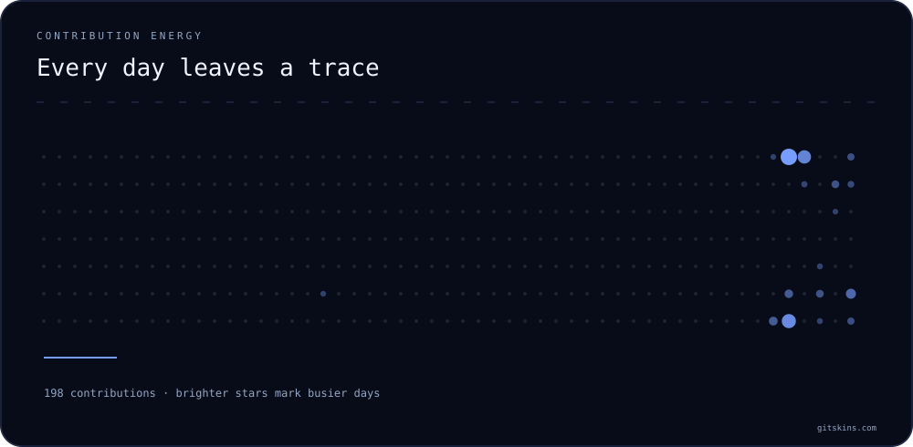
</p>

</details>

---

<div align="center">
  <sub>🌐 <strong>Connect with Manoj:</strong> <a href="https://manoj.it">manoj.it</a> · <a href="https://www.linkedin.com/in/manoj-rollo/">LinkedIn</a> · <a href="https://github.com/MRJonam91">GitHub</a> · <a href="https://www.instagram.com/mr_jonam/">Instagram</a> · <a href="https://www.youtube.com/@MrJonam91">YouTube</a> · <a href="https://www.behance.net/fbxmanoddc8">Behance</a></sub>
</div>
