<!-- project-entry:start -->
## Build, try, give feedback / Prova e contribuisci

I build local tools for traceable research, agent accounting and practical QA. / Sviluppo strumenti locali per ricerca verificabile, consumi degli agenti e QA pratico.

| Start with / Comincia da | What you can try / Cosa puoi provare |
|---|---|
| [SourcePilot](https://github.com/MRJonam91/OpenResearchEngine) | [Trace a fictional source to a cited report / Da una fonte fittizia a un report citato](https://github.com/MRJonam91/OpenResearchEngine/blob/main/docs/FIRST-RUN.md), optional local AI / AI locale opzionale |
| [AgentLedger](https://github.com/MRJonam91/AgentLedger) | [Offline token-accounting demo / Demo offline dei consumi](https://github.com/MRJonam91/AgentLedger#try-it-without-an-account), no API key / senza chiave API |
| [Calice](https://mrjonam91.github.io/Calice/) | Italian wine lessons, glossary and a local notebook / Lezioni sul vino, glossario e taccuino locale; usable alpha / alpha utilizzabile |
| [QA Express](https://github.com/MRJonam91/qa-express) | [Reusable test checklist / Checklist riutilizzabile](https://github.com/MRJonam91/qa-express/blob/main/templates/checklist.md) and a fictional report / e report fittizio |

[More projects and support routes / Altri progetti e assistenza](PROJECTS.md). Tell me what you tried and where you got stuck, using a redacted example in the relevant repository. / Racconta cosa hai provato e dove ti sei bloccato, con un esempio anonimizzato nella repository pertinente.

Voluntary support / Sostegno facoltativo: [GitHub Sponsors](https://github.com/sponsors/MRJonam91) · [Ko-fi](https://ko-fi.com/mrjonam) · [Buy Me a Coffee](https://buymeacoffee.com/mrjonam) · [PayPal](https://paypal.me/manorollo). Support grants no additional rights or licenses. / Il supporto non attribuisce licenze o diritti aggiuntivi.
<!-- project-entry:end -->

---

<div align="center">

<p><code>mrjonam91@quality-reply-node ~ $ ./system-scan --user="Manoj Rollo" --clearance="Senior-Consultant-L2"</code></p>

<!-- High-Density ASCII Biometric Scan (136x124 VISUAL.MAP) + SYSTEM.INFO + Capability Sliders -->


<!-- Terminal Typing SVG in Emerald Green & Cyan -->
<a href="https://manoj.it">
  
</a>

<br/>

<a href="https://manoj.it"></a>
<a href="https://www.linkedin.com/in/manoj-rollo/"></a>
<a href="https://github.com/MRJonam91"></a>
<a href="https://www.instagram.com/mr_jonam/"></a>
<a href="https://www.youtube.com/@MrJonam91"></a>
<a href="https://www.behance.net/fbxmanoddc8"></a>

</div>

---

## `>_ $ neofetch --career-telemetry`

```yaml
┌──[ IDENTITY & CREDENTIALS ]──────────────────────────────────────────────┐
│ User         : Manoj Rollo (@MRJonam91)                                  │
│ Current Role : QA Test Engineer, Project Manager & Team Leader (Senior L2)│
│ Organization : Concept Quality Reply · Turin, Italy                      │
│ Experience   : 11+ Years (QA Automation · Performance · PM · Digital UX) │
│ Education    : Politecnico di Torino (Cinema & Media Eng.) + Exec MBA    │
│ Certifications: Business Analysis (IIBA) · PMP Prep · Strategy (CBAP)    │
├──[ TECHNICAL ARSENAL ]───────────────────────────────────────────────────┤
│ QA & Perf    : Selenium · JMeter · Gatling · Postman · Jenkins · Polarion│
│ Languages    : TypeScript (34%) · HTML/CSS (31%) · Python (22%) · Java   │
│ AI & Systems : MCP · Ollama · RAG · WebAssembly (WASM) · CRDT · Docker   │
│ Spoken Langs : IT (100%) · EN (80%) · ES (45%) · DE (25%) · FR (25%)     │
├──[ COLOR PALETTE ]───────────────────────────────────────────────────────┤
│ ██ #0EA5E9 (Cyber Blue)   ██ #38BDF8 (Neon Cyan)   ██ #00FFA3 (Matrix)   │
└──────────────────────────────────────────────────────────────────────────┘
```

---

## `>_ $ tail -n 10 /var/log/career-and-repositories.log`

```text
[2025-NOW ] [L2-LEAD] Concept Quality Reply -> QA Test Engineer, Project Manager, Team Leader
[2023-2025] [L1-SEN ] Concept Quality Reply -> QA Test Automation & Performance, Team Leader & PM
[2022-2023] [L3-CONS] Concept Quality Reply -> QA Test Automation & Performance Engineer
[2020-2022] [QA-VAL ] Concept Quality Reply -> Load/Stress Testing (Java, Selenium, JMeter, Gatling)
[2018-2020] [UX-DEV ] Marcopolo Visualizer  -> Digital Media Engineer & UX Designer (Web, CMS, Analytics)
[REPO-AI  ] [ONLINE ] AgentLedger | TokenWatch | WASM-Sandbox | OpenAgentOS | LocalFirst-Agent | MCP-Hub
[REPO-SEC ] [ONLINE ] ZeroAuth (Passkeys/WebAuthn) | privacy-vault-ai (Encrypted RAG) | DataSovereign
[REPO-AUTO] [ONLINE ] OpenAutomationHub (n8n catalog) | freelance-project-checks | cycleAI | EdgeSync-CRDT
[REPO-CIV ] [ONLINE ] CityMirror | gtt-live-plus | posso-guidare-torino | sciopero-oggi | benzina-radar
[REPO-WEB ] [ONLINE ] pokematrix | disney-lorcana-companion | TorinoTramTour | atlante-della-birra | Calice
```

---

## `>_ $ toolbox --list && launchpad --featured`

<div align="center">
  
  <br/><br/>
  
</div>

---

## `>_ $ stats --signal && snake --eat=contributions`

<div align="center">
  
  <br/><br/>
  
  <br/><br/>
  <sub><code>system --host=manoj.it</code> · <a href="https://manoj.it">https://manoj.it</a> · <a href="https://www.linkedin.com/in/manoj-rollo/">LinkedIn</a> · <a href="https://github.com/MRJonam91">GitHub</a> · <a href="https://www.instagram.com/mr_jonam/">Instagram</a> · <a href="https://www.youtube.com/@MrJonam91">YouTube</a> · <a href="https://www.behance.net/fbxmanoddc8">Behance</a></sub>
</div>
