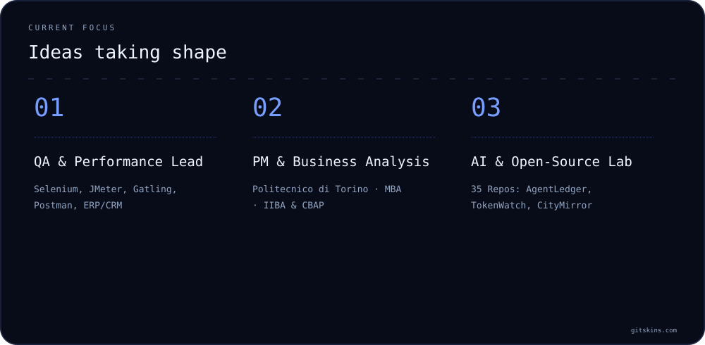
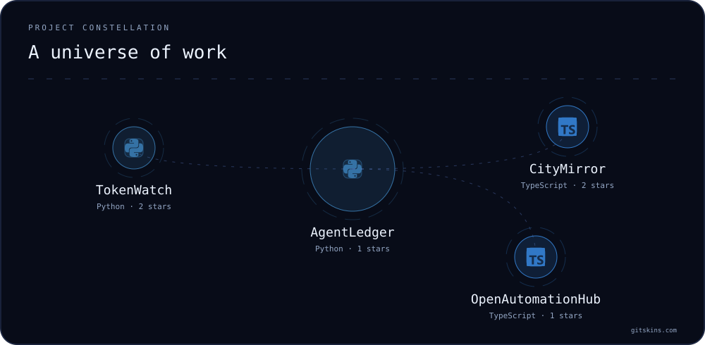
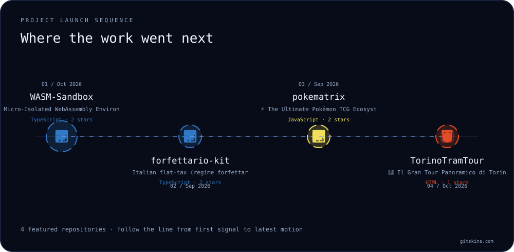
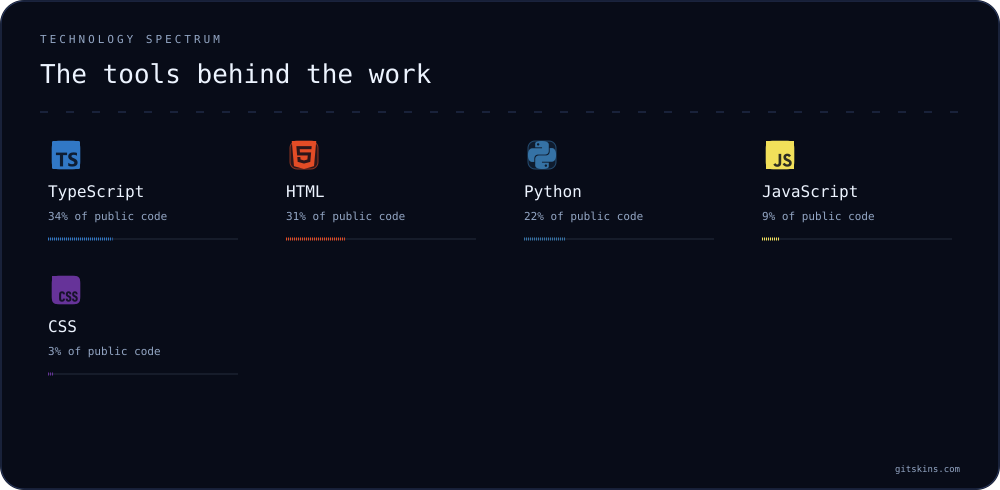
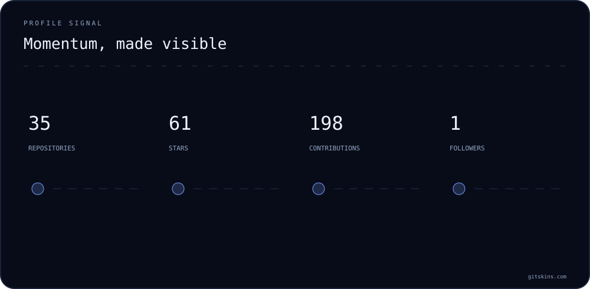
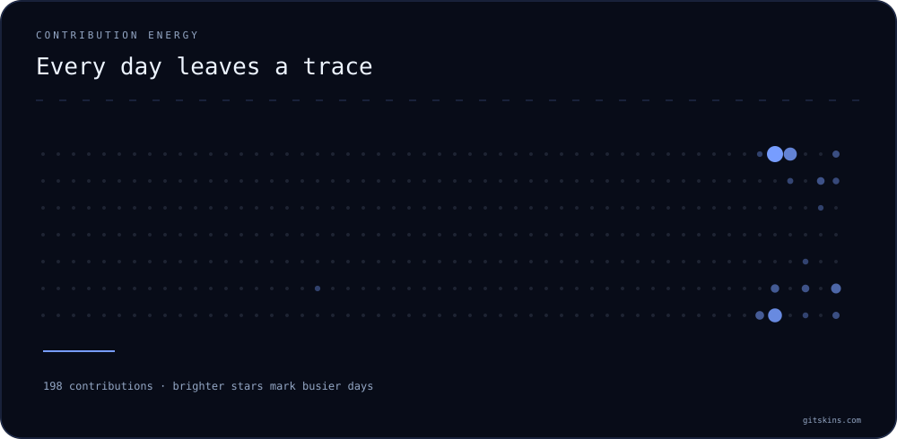

<!-- project-entry:start -->
## Build, try, give feedback / Prova e contribuisci

I build local tools for traceable research, agent accounting and practical QA. / Sviluppo strumenti locali per ricerca verificabile, consumi degli agenti e QA pratico.

| Start with / Comincia da | What you can try / Cosa puoi provare |
|---|---|
| [SourcePilot](https://github.com/MRJonam91/OpenResearchEngine) | [Trace a fictional source to a cited report / Da una fonte fittizia a un report citato](https://github.com/MRJonam91/OpenResearchEngine/blob/main/docs/FIRST-RUN.md), optional local AI / AI locale opzionale |
| [AgentLedger](https://github.com/MRJonam91/AgentLedger) | [Offline token-accounting demo / Demo offline dei consumi](https://github.com/MRJonam91/AgentLedger#try-it-without-an-account), no API key / senza chiave API |
| [Calice](https://mrjonam91.github.io/Calice/) | Italian wine lessons, glossary and a local notebook / Lezioni sul vino, glossario e taccuino locale; usable alpha / alpha utilizzabile |
| [QA Express](https://github.com/MRJonam91/qa-express) | [Reusable test checklist / Checklist riutilizzabile](https://github.com/MRJonam91/qa-express/blob/main/templates/checklist.md) and a fictional report / e report fittizio |

[More projects and support routes / Altri progetti e assistenza](PROJECTS.md). Tell me what you tried and where you got stuck, using a redacted example in the relevant repository. / Racconta cosa hai provato e dove ti sei bloccato, con un esempio anonimizzato nella repository pertinente.

Voluntary support / Sostegno facoltativo: [GitHub Sponsors](https://github.com/sponsors/MRJonam91) · [Ko-fi](https://ko-fi.com/mrjonam) · [Buy Me a Coffee](https://buymeacoffee.com/mrjonam) · [PayPal](https://paypal.me/manorollo). Support grants no additional rights or licenses. / Il supporto non attribuisce licenze o diritti aggiuntivi.
<!-- project-entry:end -->

---

✦ MANOJ ROLLO · DIGITAL ENGINEER, QA MANAGER, PM &amp; AI BUILDER · TURIN, ITALY ✦

<!-- Hero Living Identity Ultra-Dense: 134x124 Micro-Character Portrait + 3D ASCII Wordmark + Capability Bars -->

  

  <strong>Senior Consultant L2 @ Concept Quality Reply</strong> · <strong>11+ Years of Experience</strong> 
  <em>Test Automation · Performance Engineering · Project Management · Business Analysis · AI &amp; Digital Media</em>

  
  
  
  
  
  

✦ ───────────────────────────── ✦

## 🧭 Vision &amp; Multidisciplinary Profile

<table width="100%">
<tr>
<td width="62%" valign="top">
  
Software and Media Engineer graduated from <strong>Politecnico di Torino</strong> (<em>Cinema and Communication Media Engineering</em>) with an <strong>MBA in International Business (IBMI)</strong>. Bridging high-rigor engineering in <strong>Quality Assurance &amp; Performance Testing</strong> (ERP/CRM, E-Commerce, Microservices, AI) with <strong>Project Management</strong>, <strong>UX/Digital Design</strong>, and <strong>Open Source Development</strong>.

  
<strong>Core Focus:</strong> <code>Test Automation</code> · <code>Performance &amp; Load Testing</code> · <code>Project Management</code> · <code>AI Agents &amp; MCP</code> · <code>Fintech &amp; Civic Tech</code>

</td>
<td width="38%" valign="top">
  
<code>LIVE SIGNAL // MANOJ.IT</code>

  

    🔹 <strong>11+</strong> Years of Experience 
    🟢 <strong>Senior Consultant L2</strong> @ Reply 
    🔹 <strong><a href="https://github.com/MRJonam91?tab=repositories">Browse</a></strong> Open-Source Repositories 
    🟢 <strong><a href="https://github.com/MRJonam91?tab=repositories">Explore</a></strong> Projects on GitHub 
    🔹 <strong>5</strong> Spoken Languages
  

</td>
</tr>
</table>

  

✦ ───────────────────────────── ✦

## 🌌 Project Constellation &amp; Launch Timeline

  

  

✦ ───────────────────────────── ✦

## 🛠️ Technology Stack &amp; Contribution Heatmap

  

  

  

  
✨ <strong>Manoj Rollo</strong> · <a href="https://manoj.it">manoj.it</a> · <a href="https://www.linkedin.com/in/manoj-rollo/">LinkedIn</a> · <a href="https://github.com/MRJonam91">GitHub</a> · <a href="https://www.instagram.com/mr_jonam/">Instagram</a> · <a href="https://www.youtube.com/@MrJonam91">YouTube</a> · <a href="https://www.behance.net/fbxmanoddc8">Behance</a>

